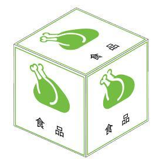
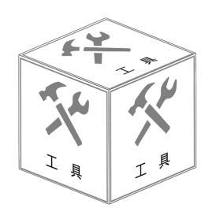
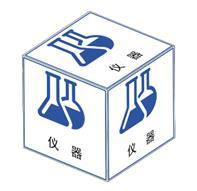
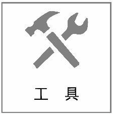
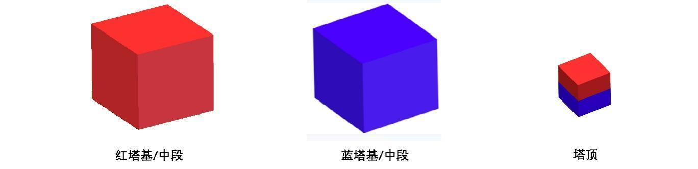

# 视觉方向免试题

本免试题分为四足方向和主赛方向，每个方向设基础、进阶两个难度。选择一个方向，完成全部基础任务即可参加基础验收；完成该方向全部基础任务及进阶任务，可参加进阶验收。

考核对象为物块本身，包括类别、位置、可见面颜色及相对面的颜色预测。所有任务均可在普通桌面或简化背景中完成。

| 难度 | 四足方向 | 主赛方向 |
| --- | --- | --- |
| 基础 | 四类物资箱识别＋单目PnP简单定位＋指定类别输出 | 红蓝方块与塔顶识别＋单目PnP简单定位＋可见面颜色识别 |
| 进阶 | 自动角点与连续定位＋箱面朝向＋多目标稳定识别 | 自动角点与连续定位＋物块姿态＋背面颜色预测 |

基础档使用普通单目相机即可，不要求购买深度相机。进阶档允许融合双目、RGB-D或点云，但仍需展示单目PnP部分的独立运行结果。

题面配图取自两份赛规原文，展示物资箱、标识贴及主赛方块，主要为示意图；各图下方标注来源，供识别外观、配色和几何关系参考。

本免试题可通过以下三种方式完成：

1. 对于有基础的同学，可以直接完成对应方向的基础任务，验收通过后参与战队相关算法工作。
2. 对于目前还不能独立完成的同学，欢迎在学习和开发过程中与算法组的学长交流。最终以实际运行效果、代码和现场交流进行验收。
3. 如果你觉得题目还不够有挑战，也欢迎带着自己的视觉项目来交流，向我们展示你的能力。

允许使用 AI、开源算法和预训练模型辅助学习与开发，但需要提交完整可运行代码，说明所使用的开源项目和模型。验收时会对关键部分随机提问，也可能现场调整目标摆放、光照或程序参数。

实现方法不限：可以使用传统图像处理、目标检测、分割、OCR、点云处理等方法，也欢迎组合使用。允许使用 ROS1 或 ROS2；不使用 ROS 的同学，应提供能够被其他程序读取的结构化结果。

### 配套浏览器仿真

可使用[视觉物块实验室](https://petershe1by.github.io/robocon-vision-lab/)生成练习数据。支持主赛与四足物块切换、同类物块复制、随机摆放、相机视角与照明调整，并能导出单目图像、相机内参及旋转视频。

基础档可以在网页中点选四角，导出角点样本后用自己的程序完成PnP；进阶档仍需自己实现自动角点和物块识别。背面颜色功能用于记录预测、翻转核对，不代替考生的预测程序。正式验收使用独立测试样本，不能把仿真模型真值作为识别程序的输入。

---

## 第一题：四足方向——物资箱识别与定位

### 具体细则如下

参考《2027年足式机器人挑战赛-V1.0》中的物资箱外观，完成一个能够连续运行的视觉程序，识别食品箱、工具箱、仪器箱、药品箱，并输出物资箱的识别与定位结果。

基础目标是识别四类物资箱，利用单目PnP估计箱面位置，并按指定类别输出目标；进阶目标是在多目标、倾斜和部分遮挡条件下，自动、稳定地识别物资箱并估计箱面位置与朝向。

本题验收视觉模块，不要求完成四足运动控制、机械臂抓取或整场自主搬运。

### 识别目标

| 物资箱类别 | 赛规标识 |
| --- | --- |
| 食品箱 | 使用赛规图3中的食品标识及文字 |
| 工具箱 | 使用赛规图3中的工具标识及文字 |
| 仪器箱 | 使用赛规图3中的仪器标识及文字 |
| 药品箱 | 使用赛规图3中的药品标识及文字 |

物资箱为边长200 mm的立方体，六面使用赛规所示的标识贴。测试时可随机摆放四类物资箱，同类允许同时出现多个。

**四类物资箱及原始标识参考图**

| 食品箱 | 工具箱 | 仪器箱 | 药品箱 |
| --- | --- | --- | --- |
|  |  |  |  |
|  |  |  |  |

来源：足式机器人挑战赛规则第7页，图3“物资箱及标识贴”。上行为箱体外观，下行为对应标识原图。

识别目标应直接采用赛规原有外观，可用纸箱制作同尺寸模型，也可在仿真中复现。允许利用原有文字、图案、颜色和几何特征，不允许另贴二维码、AprilTag或自定义编号来代替识别。

### 基础难度

**任务一：让程序能看到并识别物资。**

1. 接入实时相机、录制数据或仿真相机，显示识别结果。
2. 检测并区分四类物资箱，在画面中标出类别、检测框或轮廓、像素参考点。
3. 同一画面出现多个箱子时分别输出，能够处理同类两箱同时出现的情况。
4. 目标摆放顺序由验收人员临时调整，不能靠固定位置推断类别；没有目标或无法判断类别时，应明确输出相应状态。

**任务二：用单目PnP完成简单定位。**

1. 标定单目相机，获得相机内参和畸变参数；仿真相机可使用已知参数。
2. 选取一个完整可见的200 mm × 200 mm箱面，获得该面的四个真实角点，并与物体坐标系中对应的四个角点匹配，调用PnP方法估计位置。
3. 在画面及结构化结果中输出箱面中心的相机坐标X、Y、Z和到相机的距离，说明单位。需要区分沿光轴的深度Z与空间距离。
4. 在不同距离及至少一种斜视角度下，将估计位置与实测位置或仿真真值比较，报告误差。基础档不要求恢复箱体唯一的完整姿态。
5. 基础档允许鼠标点选四个角点，但必须说明人工操作，并在每次重摆后重新选点。物资分类仍需程序自动完成；自动角点和连续定位属于进阶要求。

**任务三：按指定类别输出物块结果。**

1. 输入指定物资类别后，列出当前可见的该类物资箱，并选择其中一个作为目标；说明选择方式，如优先选择图像中心附近的目标。
2. 通过ROS话题或JSON等形式输出时间戳、类别、检测框或轮廓、像素参考点、箱面PnP定位结果和有效性。明确区分本帧观测、人工点选帧结果与历史结果；尚未完成PnP的目标标记为未定位。
3. 当前没有指定类别时，输出“未检测到目标”；不能沿用旧结果冒充当前观测。

### 进阶难度

以下两项进阶任务均需完成。

**任务一：自动角点、连续定位与箱面朝向。**

自动获得箱面角点，连续运行PnP，输出面中心、面法向和定位有效性。处理目标倾斜、相机运动、暂时遮挡及重新出现，说明平面解歧义和结果跳变的处理方式。如输出箱体几何中心，须说明由箱面中心向箱内补偿的方法。角点不足时可以暂停定位并标为无效，重新可见后应自动恢复。

**任务二：多目标稳定识别。**

在同类多箱、箱体相邻、标签部分遮挡和光照变化下，分别输出各物资箱的类别及有效定位结果。切换指定类别后，应更新选中目标。目标被完全遮挡或移出画面时，及时标记丢失；重新出现后自动检测。可使用目标跟踪提高连续性，但不要求在完全遮挡后确定外观相同箱子的唯一身份。

---

## 第二题：主赛方向——物块识别、定位与背面颜色预测

### 具体细则如下

参考《第二十六届全国大学生机器人大赛女娲补天竞技赛规则V2》中的方块外观，完成一个能够连续运行的视觉程序，识别红色方块、蓝色方块和半红半蓝塔顶，输出物块类别、位置与颜色信息。

基础目标是识别物块、区分可见面的颜色，并用单目PnP完成简单定位；进阶目标是自动、连续地估计物块位置及可辨识姿态，结合赛规配色模型预测指定相对面的颜色。

本题验收视觉模块，不要求实现两台机器人、机械臂控制或整场建塔策略。

### 识别目标

| 目标 | 赛规外观或尺寸 | 需要识别的信息 |
| --- | --- | --- |
| 红色方块 | 350 mm × 350 mm × 350 mm，作为塔基或中段使用 | 方块类别、红色属性、位置 |
| 蓝色方块 | 与红色方块同尺寸，作为塔基或中段使用 | 方块类别、蓝色属性、位置 |
| 塔顶 | 200 mm立方体；四个侧面半红半蓝，两个相对面一红一蓝 | 位置、可见面颜色及相对面颜色预测 |

**红蓝方块与塔顶外观参考图**

来源：女娲补天竞技赛规则V2第9页，图5“比赛用品”。从左到右分别为红色塔基/中段、蓝色塔基/中段、塔顶；塔顶背面预测需结合后文六面配色定义，不能只记住图中的一种摆放姿态。

注意：塔基和中段是完全相同的物体，本题统一识别为“红色方块”或“蓝色方块”，不要求判断其在比赛中的使用角色。

目标使用赛规原有外观，可制作同尺寸模型或仿真模型，不以另贴编码标签替代目标识别。颜色结果需区分“直接观测”和“依据模型预测”；无法可靠确定时输出未知，不能只靠画面中的固定位置猜测。

### 基础难度

**任务一：识别不同类别的物块。**

1. 在实时画面、录制数据或仿真相机画面中，检测红色方块、蓝色方块和塔顶。
2. 分别输出目标类别、颜色属性、检测框或轮廓及像素参考点。同类多个物体应分别输出。
3. 验收时会同时摆放不同目标，也会改变目标与相机的距离，不能仅凭检测框的像素大小区分350 mm方块和200 mm塔顶。物块摆放位置随机，不能依靠固定位置判断类别。

**任务二：用单目PnP定位方块。**

1. 标定单目相机，使用内参、畸变参数及真实目标尺寸进行PnP定位。
2. 从350 mm红蓝方块或200 mm塔顶中选择至少一类，对一个完整可见的方形面建立四组二维、三维角点对应，输出该面中心在相机坐标系下的X、Y、Z和空间距离。
3. 基础档允许人工点选四个角点，需标注人工操作；更换目标类别或尺寸时，正确切换模型尺寸。不能把检测框的四角当作物块真实角点。
4. 用不同距离和斜视角度下的实测值或仿真真值验证定位误差。未选择的物块类别在基础档可只输出二维检测结果。

**任务三：识别可见面颜色并输出结果。**

1. 对分割或选定的物块可见面，输出“红色”“蓝色”“半红半蓝”或“无法判断”，能够区分单色面与双色面。
2. 基础档只要求可见面的颜色识别，不要求推断背面。
3. 通过ROS话题或JSON等形式输出时间戳、目标类别、可见面颜色、像素参考点、PnP定位结果及有效性。明确参考点和坐标系；未定位目标的三维字段标为不可用。

### 进阶难度

以下两项进阶任务均需完成。

**任务一：自动角点与物块连续定位。**

1. 自动获取目标角点或其他对应特征，连续完成350 mm方块和200 mm塔顶的PnP定位，并按目标类别切换真实尺寸。
2. 根据可见面的几何与颜色，输出面中心、面法向及物块的可辨识姿态；说明对称性或平面多解导致的歧义。
3. 多目标同时出现、物块倾斜或移动时，分别输出结果。目标被遮挡、移出画面或角点不足时标记失效，重新可见后自动恢复；不要求在完全遮挡后确定外观相同物块的唯一身份。

**任务二：物块背面颜色预测。**

1. 建立符合赛规的六面颜色模型，预测指定可见面的相对面颜色。本题“背面”指与该可见面相对的立方体面，不是画面中位于后方的任意区域。
2. 对全红或全蓝的350 mm方块，预测背面仍为对应颜色；对塔顶，两个相对的纯色面分别为红、蓝，其余四面均半红半蓝。预测至少覆盖“红色纯色面的背面为蓝色”“蓝色纯色面的背面为红色”“双色侧面的背面为双色侧面”三种情况。
3. 可见面不能可靠分离、目标配色模型不确定时，应输出“无法判断”。若进一步预测双色分界线在背面的具体方向，需结合姿态说明方向定义；颜色类别可确定但分布方向存在歧义时，分别标注，不强求唯一姿态。
4. 在画面或三维示意中标出用于预测的可见面、预测的相对面和预测颜色，分别标记观测结果与预测结果。不能仅在图像检测框上固定写一个相反颜色作为姿态预测展示。
5. 在揭示背面前保存预测结果，再将同一物块转动以露出先前预测的面，核对颜色；转动后的背面不能被重新定义为另一个面。使用多种摆放姿态统计预测正确率、有效预测覆盖率，并记录拒绝预测的情况。

---

## 验收与提交

两方向任选其一，分为基础、进阶两个验收档。基础档完成该方向全部基础任务；进阶档在此基础上完成两项进阶任务。可直接挑战进阶档，提交时注明所选方向与难度。最终评价结合实际效果、鲁棒性、工程完成度和对代码的理解。

1. **可运行代码：** 包含启动方式、环境与依赖、模型权重的获取方式、配置文件及标定参数。能够从说明文档复现。
2. **演示视频：** 基础档展示多目标识别、不同摆放下的PnP定位，以及指定类别输出或可见面颜色识别；人工选点时保留操作过程。进阶档另需展示连续自动定位、遮挡恢复及两项进阶任务，主赛进阶须包括先预测、再转动物块验证背面的片段。
3. **测试说明：** 说明测试目标、距离、光照、相机或仿真配置、运行硬件，给出识别正确率或检测精度/召回率、PnP位置误差及实际处理速度；区分纯计算耗时和包含人工操作的耗时。主赛进阶另需报告背面颜色预测正确率与有效预测覆盖率，不能只统计主动选出的成功样例。验收测试不应使用训练时的原图或同一视频的近邻帧充当独立测试集。
4. **现场交流：** 能够解释核心流程、所用模型、坐标变换和误差来源；能够响应目标重摆、输入类别切换或简单参数修改。

没有机器人也可以完成本题，允许使用桌面模型、录制数据或自建仿真。基础任务中的单目PnP需有已知尺寸，并完成误差验证；只在赛规截图上画框不能代替完整验收。使用仿真的应明确说明仿真条件和真实相机尚未验证的部分。

接口至少应包含时间戳、目标类别、结果有效性、像素参考点、三维参考点、坐标系与单位。三维定位无效、目标丢失或状态无法判断时，显式标记无效或未知；额外的置信度、朝向、跟踪ID等字段可按方案增加。

### 单目PnP的共同要求

- 使用真实几何角点与已知三维点的对应关系，检测框四角不能直接替代箱面四角。若使用标识贴四角，必须使用标识贴自身的实际尺寸，不能套用箱体边长。
- 明确物体坐标系原点。PnP平移向量对应所选原点在相机坐标系中的位置；原点在箱面中心时，输出的是面中心，不是箱体中心。
- 输入角点次序与所选求解方法的要求一致。可用重投影检查对应关系；重投影误差与实际位置误差分别报告。
- 对平面解歧义、角点缺失和明显不合理的结果，给出有效性标记；基础档允许在完整可见、相对静止的目标上演示，进阶档需展示自动连续处理能力。
- 定位目标为已知尺寸的比赛原有方形面，不以额外编码标记代替。方法可参考[OpenCV PnP官方说明](https://docs.opencv.org/4.x/d5/d1f/calib3d_solvePnP.html)。

允许使用AI，但最终希望看到的是你能讲清楚、能调试、能持续改进的程序。
